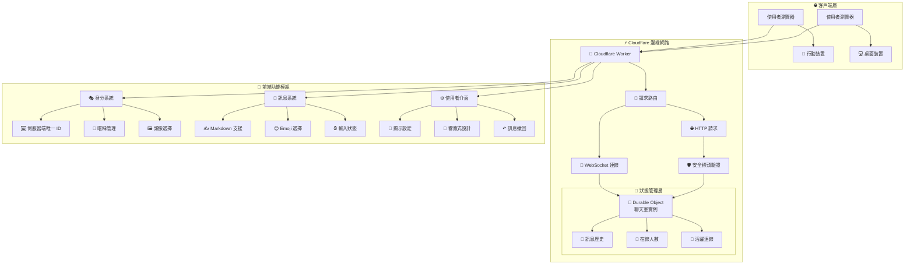
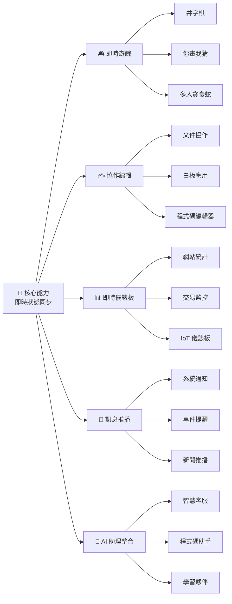
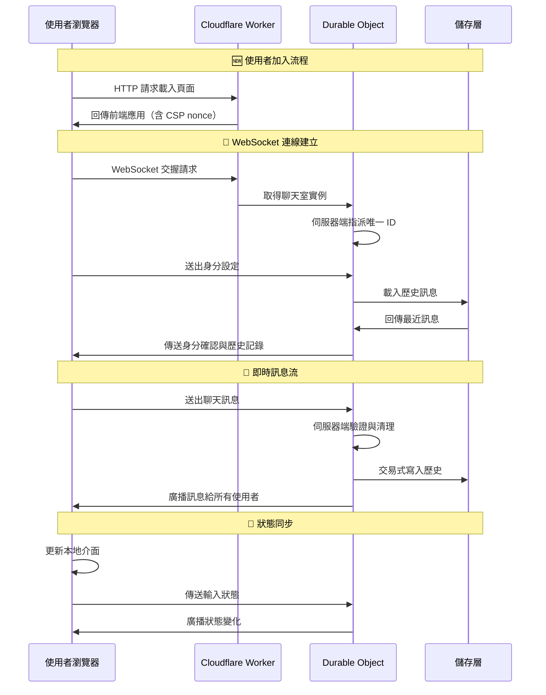
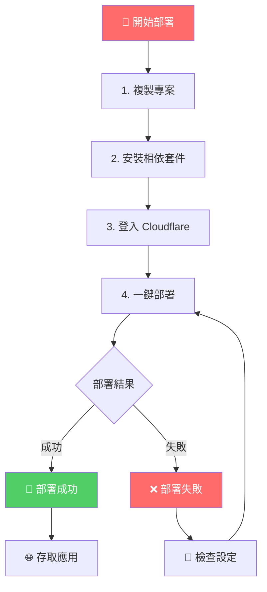
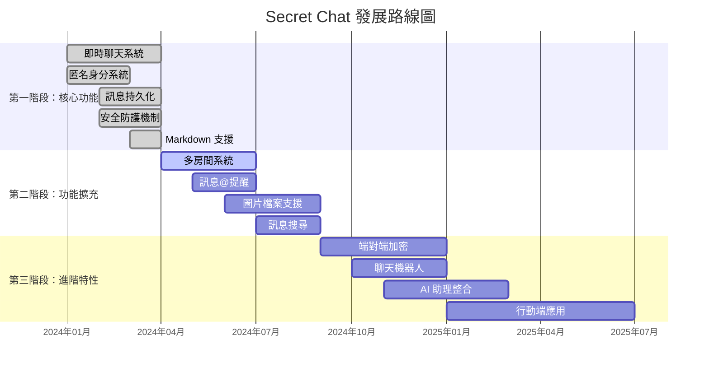

# 🤫 Secret Chat - 基於 Cloudflare 的匿名即時聊天室


** [原倉庫地址](https://github.com/lza6/CFwork-secret-chat-app/)**

> 「在程式碼的世界裡，我們不僅是建造者，更是思想的播種者。每一個字元，都可能孕育出一個連結你我的新宇宙。」

這是一個精巧而強大的專案，展示瞭如何利用 **Cloudflare 前沿技術**，在**幾乎零成本**的情況下，建構功能完善、全球低延遲的匿名即時聊天應用。它不僅僅是一個聊天室，更是探索 `Serverless`（無伺服器）與 `Edge Computing`（邊緣運算）強大潛力的起點。

我們相信技術的力量在於連結與賦能。這個專案旨在降低技術門檻，讓你親手觸碰「雲」的脈搏，感受從一行程式碼到一個全球化應用的奇妙旅程。

**👉 [立即體驗 Demo](https://cfwork-secret-chat-app.tfai.workers.dev/)** *(請將連結替換為你部署後的網域)*

---

## ✨ 核心特性

<div align="center">

### 🏗️ 系統架構總覽



</div>

### 🎨 功能亮點

| 功能模組 | 特性描述 | 技術實現 |
|---------|----------|----------|
| **🌍 全球即時同步** | 基於 Cloudflare 全球邊緣網路，提供毫秒級訊息同步體驗 | Cloudflare Workers + Durable Objects |
| **🎭 動態匿名身分** | 伺服器端指派唯一識別碼，支援自訂暱稱與頭像 | Crypto API + localStorage |
| **💾 狀態持久化** | 使用 Durable Objects 保存聊天記錄，並以交易確保寫入一致性 | Durable Objects Storage（SQLite） |
| **🚀 Serverless 架構** | 按需執行，零伺服器維運，極致成本效益 | Cloudflare Workers |
| **🛡️ 完整安全強化** | CSP、nonce、安全標頭、同源檢查、伺服器端輸入驗證 | 見下方「🛡️ 安全設計」 |
| **✍️ Markdown 支援** | 支援程式碼區塊、清單等排版，輸出前一律消毒 | Marked.js + DOMPurify |
| **📦 供應鏈防護** | 第三方腳本鎖定版本並加上 SRI 子資源完整性驗證 | integrity + crossorigin |
| **↶ 訊息撤回** | 2 分鐘內可撤回自己送出的訊息，僅限本人 | 伺服器端授權檢查 |
| **⏰ 輸入狀態** | 即時顯示誰正在輸入，自動逾時清除 | WebSocket 事件 + 心跳 |
| **📱 響應式設計** | 完美適配桌面端與行動端，提供一致體驗 | CSS Flexbox + 媒體查詢 |

---

## 🎯 應用場景

這個專案的核心是「**狀態同步**」與「**即時通訊**」，應用場景遠不只聊天室：

<div align="center">

### 💡 技術擴充藍圖



</div>

### 🏢 實際應用案例

1. **💼 企業內部溝通** - 快速搭建部門間即時通訊工具
2. **🎓 線上教育平臺** - 師生即時互動，教材共享
3. **👥 社群論壇** - 補充即時聊天功能，增強使用者黏著度
4. **🛒 電商客服** - 簡單的線上諮詢
5. **🎮 遊戲社群** - 玩家即時交流，分享攻略
6. **🚀 專案協作** - 團隊快速溝通

---

## 🛠️ 技術架構詳解

「理解原理，是賦予程式碼靈魂的第一步。」

<div align="center">

### 🔧 技術堆疊與資料流



</div>

### 核心技術元件

| 模組 | 技術 | 難度 | 職責說明 | 學習路徑 |
|------|------|------|----------|----------|
| **🌐 邊緣運算** | Cloudflare Workers | ⭐☆☆☆☆ | 全球分佈的「微型大腦」，按需執行程式碼 | `Cloudflare serverless` |
| **💾 狀態管理** | Durable Objects | ⭐⭐⭐☆☆ | 有狀態的 Worker，負責聊天室狀態管理 | `Cloudflare Durable Objects tutorial` |
| **🔗 即時通訊** | WebSocket | ⭐⭐☆☆☆ | 持久連線通道，實現雙向即時通訊 | `JavaScript WebSocket tutorial` |
| **🚀 部署工具** | Wrangler CLI (v4) | ⭐⭐☆☆☆ | 專案部署與管理的瑞士軍刀 | `wrangler cli documentation` |
| **🎨 前端介面** | 原生 JS/HTML/CSS | ⭐☆☆☆☆ | 輕量現代化使用者介面 | (Web 開發基礎) |
| **🛡️ 安全防護** | CSP + DOMPurify | ⭐⭐⭐☆☆ | 內容安全政策與 HTML 消毒，防止 XSS | `DOMPurify security` |
| **📝 格式渲染** | Marked.js | ⭐☆☆☆☆ | Markdown 到 HTML 的即時轉換 | `marked.js documentation` |
| **💾 本地儲存** | localStorage | ⭐☆☆☆☆ | 客戶端資料持久化儲存 | `Web Storage API` |
| **🆔 身分系統** | Crypto API | ⭐⭐☆☆☆ | 密碼學安全的唯一識別碼生成 | `Web Crypto API` |

### 🔍 關鍵技術原理詳解

#### 1. **Durable Objects 狀態管理** 🧠

```javascript
// 核心原理：聊天室是一個獨立的 Durable Object 實例
class ChatRoom {
  constructor(state, env) {
    this.state = state;          // 持久化狀態
    this.sessions = [];          // 活躍 WebSocket 連線
    this.lastTimestamps = new Map(); // 每個連線的速率限制紀錄
  }

  // 訊息廣播機制
  broadcast(message, excludeId = null) {
    this.sessions = this.sessions.filter((session) => {
      if (session.id === excludeId) return true;
      if (!session.isIdentified && message.type !== 'status') return true;
      try {
        session.ws.send(JSON.stringify(message));
        return true;
      } catch (err) {
        session.quit = true;
        return false;
      }
    });
  }
}
```

**運作原理**：每個聊天室對應一個 Durable Object，它在 Cloudflare 邊緣網路上保持活躍狀態，管理所有連線的使用者工作階段與訊息歷史。訊息以**交易（transaction）**方式寫入，確保配額檢查、訊息寫入與計數是一次性完成的，不會因並行請求而遺失訊息或突破配額。

#### 2. **WebSocket 即時通訊** 🔄

```javascript
// WebSocket 連線處理
async handleSession(ws) {
  ws.accept();

  // 身分識別碼由伺服器端產生，絕不信任客戶端傳入的值
  const session = {
    ws,
    id: crypto.randomUUID(),
    name: '',
    avatar: '',
    isIdentified: false,
  };
  this.sessions.push(session);

  // 等待客戶端完成身分設定後，才提供歷史訊息
  ws.addEventListener('message', async (msg) => {
    const data = JSON.parse(msg.data);
    if (data.type === 'identity') {
      session.name = normalizeText(data.name, 24);
      session.avatar = normalizeText(data.avatar, 16);
      session.isIdentified = true;
    }
  });
}
```

**即時性保證**：WebSocket 保持持久連線，訊息延遲通常在 50–200ms，取決於使用者到最近邊緣節點的距離。連線閒置時會由客戶端每 25 秒送出一次心跳（`ping`），伺服器回覆 `pong`，可即時偵測斷線。

#### 3. **伺服器端輸入驗證** 🛡️

```javascript
// 所有使用者輸入都會先經過清理，移除控制字元與零寬/雙向文字
var CONTROL_CHARS_PATTERN = /[\u0000-\u0008\u000B\u000C\u000E-\u001F\u007F-\u009F]/g;
var INVISIBLE_CHARS_PATTERN = /[\u200B\u200C\u200E\u200F\u202A-\u202E\u2060\u2066-\u2069\uFEFF]/g;

function normalizeText(value, maxLength) {
  if (typeof value !== 'string') return '';
  return value
    .replace(/\r\n?/g, '\n')
    .replace(CONTROL_CHARS_PATTERN, '')
    .replace(INVISIBLE_CHARS_PATTERN, '')
    .slice(0, maxLength);
}
```

**防護重點**：去除零寬字元與 Unicode 雙向覆寫字元（Bidi Override），可避免攻擊者以不可見字元偽造暱稱、混淆程式碼日誌或隱藏惡意內容；`maxLength` 同時限制記憶體與儲存空間的消耗。

---

## 🚀 快速部署指南

> "Talk is cheap, show me the code... and the button!"

我們已將部署過程簡化到極致，只需幾個指令即可擁有自己的全球聊天應用。

### 📋 環境準備

1.  **[註冊 Cloudflare 帳號](https://dash.cloudflare.com/sign-up)** - 完全免費
2.  **[安裝 Node.js](https://nodejs.org/)** - 建議 Node.js 20 以上（LTS）
3.  **[安裝 Git](https://git-scm.com/downloads)** - 程式碼版本管理

### 🎯 部署三步曲

<div align="center">

### 📦 部署流程



</div>

**第一步：取得程式碼 💻**
```bash
# 複製專案到本機
git clone https://github.com/lzA6/CFwork-secret-chat-app.git
cd CFwork-secret-chat-app
```

**第二步：環境設定 🔑**
```bash
# 安裝專案相依套件（會安裝 Wrangler v4）
npm install

# 登入 Cloudflare 帳號（會自動開啟瀏覽器）
npx wrangler login
```

**第三步：一鍵部署 🚀**
```bash
# 部署到 Cloudflare 全球網路
npm run deploy
```

部署成功後，終端機會顯示你的專屬存取連結：
```
✅ Deployment complete!
Your project is available at: https://cfwork-secret-chat-app.your-username.workers.dev
```

**恭喜！你的全球匿名聊天室已經上線運作！🎉**

### 📄 設定檔說明（wrangler.jsonc）

本專案使用 **`wrangler.jsonc`**（JSON with Comments）作為 Wrangler 設定檔，已取代舊版的 `wrangler.toml`：

```jsonc
{
  "$schema": "node_modules/wrangler/config-schema.json",
  "name": "cfwork-secret-chat-app",
  "main": "src/index.js",
  "compatibility_date": "2025-10-01",
  "observability": { "enabled": true },
  "durable_objects": {
    "bindings": [
      { "name": "CHAT_ROOM", "class_name": "ChatRoom" }
    ]
  },
  "migrations": [
    { "tag": "v1", "new_sqlite_classes": ["ChatRoom"] }
  ]
}
```

| 欄位 | 說明 |
|------|------|
| `name` | Worker 名稱，同時決定預設網域名稱（`<name>.<帳號>.workers.dev`） |
| `main` | 進入點檔案，本專案為 `src/index.js` |
| `compatibility_date` | 相容性日期，決定可用平臺 API 的版本 |
| `observability` | 開啟 Workers Logs，方便排查線上錯誤 |
| `durable_objects.bindings` | 將 `CHAT_ROOM` 綁定到 `ChatRoom` 類別 |
| `migrations` | Durable Object 類別遷移；`new_sqlite_classes` 為內建 SQLite 版本（免費方案可用） |

> 💡 若你仍使用 `wrangler.toml`，Wrangler 會自動改用 `wrangler.jsonc`；請勿同時保留兩份設定檔，以免產生混淆。

### 🧪 本機開發

```bash
# 啟動本機開發伺服器（預設 http://localhost:8787）
npm run dev

# 即時查看線上日誌
npm run tail
```

### ⚙️ 進階設定（選用）

- **自訂網域**：於 Cloudflare Dashboard 的 Workers & Pages 中，為此 Worker 綁定自訂網域。
- **環境變數**：`wrangler.jsonc` 中的 `vars` 區塊可加入自訂環境變數（**請勿**把任何金鑰直接寫進設定檔，請改用 `wrangler secret put <NAME>` 存入加密變數）。
- **正式環境與測試環境**：可使用 `wrangler.jsonc` 的 `env` 欄位區隔不同環境。

---

## 🛡️ 安全設計

本專案在 v1.1.0 進行了一輪完整的安全強化，以下是實際落實的項目：

### ✅ 已實作的安全措施

| 項目 | 說明 |
|------|------|
| **內容安全政策（CSP）** | 以 `default-src 'none'` 為基準，內嵌腳本使用每份回應隨機產生的 `nonce`，並禁止 `object-src`、`base-uri`、`frame-ancestors` |
| **安全回應標頭** | `X-Content-Type-Options: nosniff`、`X-Frame-Options: DENY`、`Referrer-Policy: no-referrer`、`Permissions-Policy`、`Strict-Transport-Security` |
| **同源 WebSocket 檢查** | 驗證 `Origin` 主機與請求主機一致，阻擋跨站 WebSocket 劫持（CSWSH） |
| **伺服器端身分指派** | 唯一識別碼由伺服器產生，不接受客戶端自帶 ID，杜絕冒用他人身分撤回訊息 |
| **輸入驗證與清理** | 限制暱稱 24 字、訊息 2000 字；移除控制字元、零寬字元與雙向覆寫字元；單一訊框超過 16 KB 直接拒絕 |
| **速率限制** | 訊息 500 ms／輸入狀態 1 s／身分更新 1 s／心跳 10 s；每日訊息上限 100,000 則 |
| **交易式寫入** | 配額檢查、訊息寫入與計數在同一交易內完成，避免競態造成配額繞過或訊息遺失 |
| **供應鏈防護** | `marked` 與 `DOMPurify` 鎖定版本並加上 SRI 完整性雜湊；元件載入失敗時自動退回純文字模式（fail-closed） |
| **前端 XSS 防護** | 預設以 `escapeHtml` 輸出；啟用 Markdown 時仍必須經過 DOMPurify 消毒，DOM 組裝一律使用 `textContent` |
| **歷史訊息授權** | 未完成身分設定的連線無法讀取歷史訊息，避免匿名探訪者窺看對話內容 |
| **錯誤訊息不外洩** | 例外不再回傳原始錯誤內容，改為固定訊息並記錄至 Workers Logs |
| **資源上限** | 單一聊天室最大 1000 個活躍連線；歷史訊息最多 100 則且總量不超過 100 KB |

### 🧪 自行驗證

```bash
# 確認設定檔格式正確
npx wrangler deploy --dry-run

# 檢查回應是否帶有安全標頭
curl -I https://<your-worker>.workers.dev/
```

---

## 📖 詳細使用教程

### 🎭 首次使用設定

1. **存取應用** - 開啟部署後的連結
2. **設定身分** - 點擊右上角齒輪開啟設定面板
3. **選擇頭像** - 從表情符號中選擇你的頭像
4. **輸入暱稱** - 建立獨特的線上身分
5. **開始聊天** - 在輸入框送出第一則訊息！

> 💡 送出訊息前必須先設定暱稱，伺服器會驗證身分後才提供歷史訊息與廣播權限。

### 💬 核心功能操作

#### 送出訊息
- **文字訊息**：直接輸入文字，最長 2000 字
- **Markdown 渲染**：於設定面板開啟「渲染富文本」，支援標題、清單、程式碼區塊
- **Emoji**：點選表情按鈕插入符號
- **撤回訊息**：2 分鐘內可撤回自己送出的訊息（僅限本人）

#### 進階功能
- **輸入狀態**：其他使用者正在輸入時會即時顯示
- **在線人數**：頂部狀態列顯示目前人數與今日剩餘訊息配額
- **長訊息折疊**：超過 200 字的訊息會摺疊，點擊即可展開
- **重新整理歷史**：重新載入頁面即可重新載入最近訊息

### 🎨 個人化設定

在設定面板中，你可以：
- 調整載入的歷史訊息數量（1～100）
- 開啟/關閉 Markdown 渲染
- 選擇頭像與暱稱（會儲存在瀏覽器 `localStorage`）

---

## ⚖️ 架構分析與思考

「沒有完美的程式碼，只有不斷進化的思想。」

### ✅ 架構優勢

<div align="center">

### 🏆 技術優勢對比

| 特性 | 傳統架構 | **Secret Chat** | 優勢分析 |
|------|----------|-----------------|----------|
| **💰 成本** | 伺服器固定費用 | **按使用量計費** | 節省 90%+ 成本 |
| **🌍 延遲** | 單區域部署 | **全球邊緣部署** | 延遲降低 50-80% |
| **🔄 維運** | 複雜伺服器管理 | **完全免維運** | 零維運工作量 |
| **📈 擴充** | 手動擴充 | **自動無限擴充** | 秒級因應流量高峰 |
| **🛡️ 安全** | 自行維護 | **平臺級安全 + CSP** | 企業級安全防護 |

</div>

### ⚠️ 架構限制

1.  **Durable Object 地域限制** - 單一實例存在地域限制，全球使用者連線可能產生延遲差異
2.  **冷啟動延遲** - 休眠狀態喚醒時需要數百毫秒到數秒的初始化時間
3.  **狀態查詢限制** - 不適合複雜的關聯查詢與大規模資料分析場景
4.  **單一聊天室** - 目前為全站共用一個聊天室（`global-chat-room`），尚未支援多房間
5.  **歷史訊息上限** - 最多保留 100 則訊息，且總量不超過 100 KB

### 💡 架構哲學

技術選項總是一場權衡。我們選擇 `Serverless` 與 `Durable Objects`，是用「狀態管理」的限制換取「全球化」、「低成本」與「免維運」的巨大優勢。

這就像極簡主義：放棄笨重傢俱，獲得隨時出發的自由。我們的程式碼輕盈靈活，能在全球每個角落快速安家。

**我們是否真的需要複雜系統？還是可以用更聰明的方式解決核心問題？** 這不僅是技術選擇，更是追求高效、簡約的價值觀體現。

---

## 🗺️ 發展路線圖

「一個專案的偉大，不在於它現在是什麼，而在於它將要成為什麼。」

<div align="center">

### 🚀 功能演進規劃



</div>

### 🎯 近期規劃

| 優先級 | 功能 | 技術方案 | 預計週期 |
|--------|------|----------|----------|
| 🔥 高 | **多房間系統** | 以房間名稱做 Durable Object 分片 | 2-3 週 |
| 🔥 高 | **圖片檔案支援** | Cloudflare R2 + 預簽章 URL | 3-4 週 |
| 🔥 高 | **訊息@提醒** | 使用者提及偵測與高亮顯示 | 1-2 週 |
| 🔶 中 | **訊息搜尋** | 客戶端索引 + 伺服器端過濾 | 2-3 週 |
| 🔶 中 | **主題系統** | CSS 變數 + 本地儲存 | 1 週 |

### 🛠️ 技術演進路徑

1.  **多房間系統實作**
    ```javascript
    // 技術方案：以路徑為基礎的路由
    const roomName = new URL(request.url).pathname.split('/').pop() || 'main';
    const roomId = env.CHAT_ROOM.idFromName(roomName);
    const room = env.CHAT_ROOM.get(roomId);
    ```

2.  **檔案上傳架構**
    ```mermaid
    graph LR
        A[前端選擇檔案] --> B[取得預簽章URL]
        B --> C[直傳R2儲存]
        C --> D[回傳檔案URL]
        D --> E[傳送訊息]
        E --> F[廣播渲染]
    ```

3.  **全球延遲最佳化** - 區域性 Durable Objects + 狀態同步機制

---

## 📂 專案結構

```
CFwork-secret-chat-app/
├── 📄 package.json                 # 專案設定與相依套件管理
├── ⚙️ wrangler.jsonc                # Cloudflare Workers 設定（JSONC）
├── 🔒 .gitignore                   # Git 忽略規則
├── 📝 README.md                    # 專案說明文件
└── 📁 src/
    └── 🚀 index.js                 # 核心應用邏輯（前後端一體）
        ├── 🧠 ChatRoom Class       # Durable Object 聊天室實作
        ├── 🌐 Worker Entrypoint    # 請求路由與安全標頭
        ├── 🎨 HTML Template        # 前端介面範本（含 CSP nonce）
        ├── ⚡ Frontend JS          # 客戶端互動邏輯
        └── 🔧 Utility Functions    # 工具函式集合
```

### 🔍 核心檔案詳解

#### `src/index.js` - 應用主進入點
- **Worker 進入點**：處理所有 HTTP 與 WebSocket 請求
- **路由邏輯**：依請求類型分派，WebSocket 另做同源檢查
- **安全標頭**：產生 CSP nonce 與安全回應標頭

#### `ChatRoom Class` - 聊天室核心邏輯
- **工作階段管理**：維護所有活躍的 WebSocket 連線
- **訊息廣播**：即時向所有使用者推播訊息
- **狀態持久化**：以交易將訊息歷史寫入 Durable Objects 儲存
- **使用者管理**：處理身分設定、上線與離線狀態

#### 前端元件結構
```javascript
// 前端主要模組
const frontendModules = {
  ui: {},           // UI 元素參考
  state: {},        // 應用狀態管理
  websocket: {},    // WebSocket 通訊
  render: {},       // 介面渲染
  utils: {}         // 工具函式
};
```

---

## 🔧 技術深度解析

### 🎯 核心技術難點與解決方案

#### 1. **即時訊息同步** ⚡

**難點**：確保所有客戶端訊息順序一致，處理網路延遲與重新連線。

**解決方案**：
```javascript
// 伺服器端以交易確保訊息順序與配額一致
const stored = await this.state.storage.transaction(async (txn) => {
  const history = (await txn.get('messages')) || [];
  history.push(message);
  while (history.length > LIMITS.MAX_HISTORY) history.shift();
  await txn.put('messages', history);
  await txn.put('dailyWrites', dailyWrites + 1);
  return true;
});
```

#### 2. **前端安全渲染** 📁

**難點**：使用者輸入可能包含 XSS 載荷，而 Markdown 解析後也會產生 HTML。

**解決方案**：
```javascript
// 預設輸出為純文字；啟用 Markdown 時仍必須經過消毒
function renderRichText(raw) {
  if (typeof window.marked === 'undefined' || typeof window.DOMPurify === 'undefined') {
    return null; // 元件不可用時退回純文字（fail-closed）
  }
  const html = window.marked.parse(raw, { breaks: true });
  return window.DOMPurify.sanitize(html, { USE_PROFILES: { html: true } });
}
```

#### 3. **重新連線策略** 🔗

**難點**：避免連線中斷時產生連線風暴，同時兼顧使用者體驗。

**解決方案**：
```javascript
// 指數退避 + 20% 隨機抖動，上限 30 秒；心跳 pong 會重設計數
const delay = Math.min(30000, (Math.pow(2, reconnectAttempts) * 1000));
const jitter = delay * 0.2 * Math.random();
setTimeout(connect, delay + jitter);
```

### 🚀 效能最佳化策略

1. **訊息歷史分頁**：只載入最近 N 則訊息（可於設定面板調整）
2. **單一鍵值儲存**：歷史訊息集中存放，讀寫次數最少
3. **WebSocket 心跳**：每 25 秒一次心跳，及時偵測斷線
4. **本地儲存快取**：使用者設定與身分資訊保存在瀏覽器端
5. **日誌最小化**：只在錯誤時記錄，避免大量 IO

---

## 🎯 目前完成度與待實作功能

### ✅ 已實作核心功能

| 功能模組 | 完成度 | 技術實現狀態 |
|---------|--------|-------------|
| **基礎聊天** | 🟢 100% | 穩定執行，支援文字與表情 |
| **匿名身分系統** | 🟢 100% | 伺服器端唯一 ID + 自訂暱稱頭像 |
| **訊息持久化** | 🟢 100% | Durable Objects（SQLite）交易式儲存 |
| **即時同步** | 🟢 100% | WebSocket 全雙工通訊 |
| **回應式 UI** | 🟢 100% | 行動端友善設計 |
| **安全強化** | 🟢 100% | CSP、SRI、同源檢查、輸入驗證 |
| **Markdown 渲染** | 🟢 100% | Marked + DOMPurify（可開關） |

### 🟡 部分實作功能

| 功能模組 | 完成度 | 目前狀態 |
|---------|--------|----------|
| **訊息撤回** | 90% | 2 分鐘內可撤回，僅限本人 |
| **在線狀態** | 90% | 顯示在線人數與剩餘配額，支援心跳偵測 |
| **輸入狀態** | 80% | 支援輸入提示，尚未支援「停止輸入」事件 |

### 🔴 待實作功能

| 功能模組 | 優先級 | 技術挑戰 | 預計工作量 |
|---------|--------|----------|-----------|
| **多房間聊天** | 🔥 高 | Durable Object 分片管理 | 3-4 週 |
| **端對端加密** | 🔥 高 | 金鑰管理 + 效能影響 | 4-5 週 |
| **訊息搜尋** | 🔥 高 | 客戶端索引建立 | 2-3 週 |
| **AI 助理整合** | 🔶 中 | API 整合 + 上下文管理 | 3-4 週 |
| **行動端應用** | 🔶 中 | React Native / Flutter | 6-8 週 |
| **語音訊息** | 🔶 低 | 音訊處理 + 儲存最佳化 | 4-5 週 |

---

## 🛠️ 開發者擴充指南

### 🔌 可擴充性設計

#### 1. **外掛系統架構**
```javascript
// 外掛註冊機制
const plugins = {
  messageProcessors: [],
  uiExtensions: [],
  eventHandlers: []
};

function registerPlugin(plugin) {
  plugins.messageProcessors.push(...(plugin.messageProcessors || []));
  // ... 註冊其他外掛元件
}
```

#### 2. **訊息處理管線**
```javascript
// 可擴充的訊息處理
async function processMessage(message) {
  for (const processor of plugins.messageProcessors) {
    message = await processor(message);
  }
  return message;
}
```

### 🎨 UI 元件擴充

#### 自訂主題系統
```css
/* 以 CSS 變數為基礎的主題系統 */
:root {
  --theme-color: #007bff;
  --bg-color: #f0f2f5;
  --panel-bg: #fff;
  /* 更多設計權杖... */
}

[data-theme="dark"] {
  --theme-color: #4dabf7;
  --bg-color: #1a1a1a;
  --panel-bg: #2d2d2d;
}
```

#### 元件化訊息類型
```javascript
// 支援自訂訊息類型渲染
const messageRenderers = {
  text: renderTextMessage,
  image: renderImageMessage,
  file: renderFileMessage,
  // 可擴充新的訊息類型
  custom: renderCustomMessage
};
```

### 🔧 後端服務擴充

#### 1. **資料庫整合**
```javascript
// 支援外部資料庫儲存
async function storeMessageInDB(message) {
  // 整合 Supabase、PlanetScale 等
  const dbResponse = await fetch(DB_ENDPOINT, {
    method: 'POST',
    body: JSON.stringify(message)
  });
  return dbResponse.ok;
}
```

#### 2. **第三方服務整合**
```javascript
// AI 服務整合範例
async function getAIResponse(message) {
  const response = await fetch('https://api.openai.com/v1/chat/completions', {
    method: 'POST',
    headers: { 'Authorization': `Bearer ${OPENAI_KEY}` },
    body: JSON.stringify({
      model: "gpt-3.5-turbo",
      messages: [{ role: "user", content: message.text }]
    })
  });
  return await response.json();
}
```

> ⚠️ 請務必把 `OPENAI_KEY` 之類的機密改用 `wrangler secret put` 存放，切勿寫入程式碼或 `wrangler.jsonc`。

---

## 📊 效能基準測試

### 🚀 效能指標

| 指標 | 目前表現 | 目標最佳化 |
|------|----------|----------|
| **訊息延遲** | 50-200ms | < 100ms |
| **並行使用者** | 100+ | 1000+ |
| **啟動時間** | 1-2s | < 500ms |
| **記憶體使用** | 10-50MB | 維持穩定 |

### 🔍 最佳化建議

1. **程式碼分割**：將大型 JS 檔案拆分為按需載入的模組
2. **圖片最佳化**：實作 WebP 格式支援與響應式圖片
3. **快取策略**：加強伺服器端與客戶端快取機制
4. **資料庫索引**：為訊息搜尋功能建立合適索引

---

## 🐛 常見問題解答

### ❓ 技術問題

**Q: 為什麼選擇 Durable Objects 而不是傳統資料庫？**
A: Durable Objects 提供了內建的即時同步能力，避免了資料庫查詢的延遲，特別適合聊天這種高併發的即時應用。

**Q: 為什麼歷史訊息只保留 100 則？**
A: 這是單一聊天室共享一個儲存鍵的取捨。100 則訊息搭配 100 KB 的總量上限，可以確保不會超出 Durable Objects 的單一鍵值大小限制；想長期保存可自行擴充資料模型（例如改用 R2 或 D1）。

**Q: 如何保證訊息的安全性？**
A: 伺服器端限制並清理所有輸入（含零寬與雙向字元）、以伺服器端指派的身分驗證授權、CSP 與 SRI 防止惡意腳本注入、DOMPurify 消毒 Markdown 輸出、限制訊息框大小避免資源耗用。

**Q: 為什麼需要 `new_sqlite_classes`？**
A: 這是使用內建 SQLite 儲存的 Durable Object 類別寫法，免費方案即可使用；若改用 `new_classes` 則為舊版 KV 儲存，單一鍵值上限僅 128 KB。

### ❓ 使用問題

**Q: 訊息歷史會保存多久？**
A: 聊天室只保留最近 100 則訊息（且總量不超過 100 KB），每次重新連線都會載入目前的歷史記錄。

**Q: 為什麼還看不到其他人的訊息？**
A: 請先在設定面板填寫暱稱並儲存。伺服器只會把訊息廣播給已完成身分設定的連線，歷史訊息也只提供給已識別的連線。

**Q: 支援多大的訊息長度？**
A: 單則訊息最多 2000 個字元，超過會在送出前被限制，伺服器端也會再次驗證。

**Q: 如何建立私密聊天室？**
A: 目前為全站共用的單一聊天室，多房間功能仍在規劃中（見「近期規劃」）。

---

## 🤝 貢獻與致謝

感謝你閱讀到這裡！你對這個專案的好奇心，正是開源世界生生不息的火焰。

我們堅信最好的學習方式就是動手實作。不要害怕犯錯，每一次 `ERROR` 都是一次成長的機會。我們都曾經歷從「完全不懂」到「好像有點明白了」再到「原來如此！」的頓悟時刻。

### 🎁 如何參與貢獻

1. **回報問題** - 遇到 Bug？歡迎提交 Issue
2. **功能建議** - 有好的想法？告訴我們！
3. **程式碼貢獻** - 直接提交 Pull Request
4. **文件改進** - 協助完善使用文件
5. **分享案例** - 告訴我們你的使用場景

### 📜 開源授權

本專案基於 [Apache 2.0](https://opensource.org/licenses/Apache-2.0) 授權開源，你可以自由使用、修改與散佈。

---

## 📝 更新日誌

### v1.1.0
- ✅ 全面改用繁體中文（介面、文件、設定檔）
- ✅ 部署設定改用 `wrangler.jsonc`，升級至 Wrangler v4
- ✅ 完整安全強化：CSP nonce、安全回應標頭、同源 WebSocket 檢查
- ✅ 伺服器端指派唯一 ID，杜絕冒用身分
- ✅ 伺服器端輸入驗證、字元清理、速率限制與資源上限
- ✅ 交易式寫入訊息與配額，修正競態問題
- ✅ 第三方腳本鎖版並加上 SRI 完整性驗證
- ✅ 前端 XSS 防護與 DOM 組裝重構，修正換行顯示錯誤
- ✅ 重新連線心跳與頁面離開時的資源清理

### v1.0.0
- ✅ 基礎即時聊天功能
- ✅ 匿名身分系統
- ✅ 訊息持久化
- ✅ 回應式介面設計

### v1.2.0（規劃中）
- 🔄 多房間聊天支援
- 🔄 訊息搜尋功能
- 🔄 主題切換系統
- 🔄 效能最佳化

---

<div align="center">

## 🎉 開始你的 Serverless 之旅

**大膽嘗試，勇敢探索，用程式碼創造無限可能！**

[🚀 立即部署](#-快速部署指南) | [🐛 回報問題](https://github.com/lzA6/CFwork-secret-chat-app/issues) | [💡 功能建議](https://github.com/lzA6/CFwork-secret-chat-app/discussions)

*「程式碼如詩，架構如畫，願你的每一行程式碼都能點亮他人的世界。」*

**Happy Hacking! 🚀**

</div>

---

*最後更新：v1.1.0*
*由 [lzA6](https://github.com/lzA6) 用 ❤️ 和 ☕ 建構*
